Отчет по лабораторной работе 1

Система управления складом

Цель работы

Разобраться с классами наследованием копированием и перемещением
Сделать склад с разными товарами и применить фабричный метод и итератор

Как устроена программа

Warehouse хранит товары в vector через unique_ptr
У каждого товара один владелец поэтому при удалении он освобождается автоматически
Вместимость ограничивает число товаров в списке а не сумму их остатков
Ноль и отрицательная вместимость не допускаются

Product это общий абстрактный класс товара
В нем находятся id название цена количество вес и категория
От него наследуются Electronics Clothing и Food
Дальше идут конкретные товары Smartphone Laptop TShirt Jacket Milk и Bread
Цена количество и вес вынесены в классы Price Quantity и Weight
Они проверяют чтобы значения не были отрицательными

Объявления лежат в include а реализация в src
Сценарии находятся в main.cpp а меню в Console.cpp

UML диаграмма

[Исходник диаграммы](warehouse.puml)

Фабричный метод

ProductFactory задает общий метод createProduct
Для каждого товара есть своя фабрика которая переопределяет этот метод
Например SmartphoneFactory создает Smartphone а MilkFactory создает Milk
Метод возвращает unique_ptr на Product поэтому склад может хранить разные товары вместе

clone нужен для другой задачи
Он создает копию уже существующего товара и используется при копировании склада

Итератор

WarehouseIterator нужен чтобы перебирать товары не обращаясь напрямую к вектору
begin дает начало а end позицию после последнего товара
Оператор * дает текущий товар а ++ переходит к следующему
Операторы == и != сравнивают позиции

ConstWarehouseIterator используется когда товары можно только читать
После добавления или удаления товара старый итератор может стать недействительным

Правило пяти

Конструктор копирования создает новый склад и вызывает clone для каждого товара
Поэтому товары копии не связаны с товарами оригинала

Копирующее присваивание заменяет содержимое уже существующего склада
Сначала подготавливаются копии товаров потом ими заменяется старое содержимое
При присваивании склада самому себе ничего не меняется

Конструктор перемещения передает вектор товаров новому складу через std::move
Сами товары при этом не копируются

Перемещающее присваивание делает такой же перенос в уже существующий склад
Его прежние товары освобождаются

Деструктор оставлен по умолчанию
vector и unique_ptr сами освобождают товары
После копирования и перемещения у товаров обновляется ссылка на склад владельца

Результаты сценариев

Сценарий 1
Создан склад на 6 товаров
Через разные фабрики добавлены все шесть типов и выведены через итератор
Все товары появились в списке

Сценарий 2
Создана копия склада с телефоном
В копии цена изменена на 750 а количество на 7
В оригинале остались цена 700 и количество 4
Копия меняется независимо

Сценарий 3
Склад с ноутбуком передан через конструктор перемещения
В исходном складе стало 0 товаров а в новом 1
В тесте правила пяти также проверено что адрес товара при перемещении сохраняется

Сценарий 4
По id 31 найден ноутбук
По категории Electronics найдены 2 товара а по цене 2 найден 1 товар
После удаления по id и по индексу остался 1 товар

Сценарий 5
Молоко перенесено во второй склад
В первом складе стало 0 товаров
После изменения у молока цена 4 и количество 8

Проверка программы

Оставлены 5 тестовых функций
Проверяются атрибуты фабрики вместимость правило пяти и итератор
Все 5 прошли
В CTest прошли обе проверки это тесты классов и запуск пяти сценариев
Сборка с AddressSanitizer и UndefinedBehaviorSanitizer на этих запусках ошибок не показала

[Вывод сценариев](results/demo-output.txt)
[Вывод тестов](results/unit-output.txt)
[Результат CTest](results/ctest-output.txt)

Ограничения

Проверены сценарии задания но не все возможные случаи
При прямом вызове Quantity::change возможно переполнение int
Счетчик id тоже ограничен диапазоном int
Проверка Weight в самом классе пропускает NaN и бесконечность
Присваивание отдельного товара может скопировать его id и ссылку на склад
При нехватке памяти во время переноса возможна потеря товара
В меню часть неправильного ввода отсекается отдельно

Вывод

Получилась система склада с шестью видами товаров
Фабрики создают товары а итератор позволяет их обходить
Копирование создает отдельные товары а перемещение передает уже существующие
На сценариях получилось проверить разницу между этими действиями
